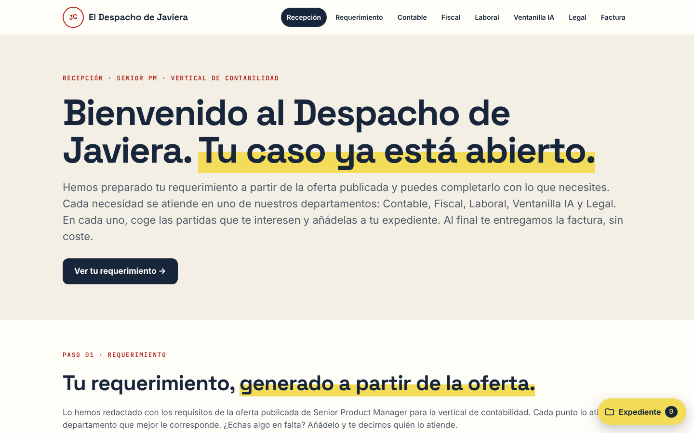
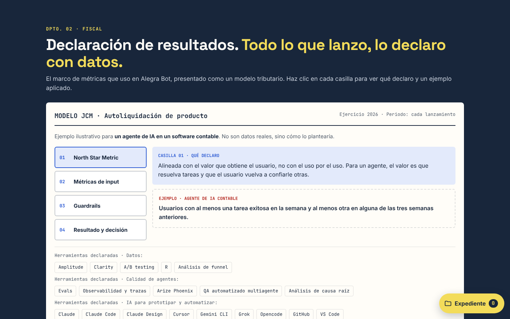
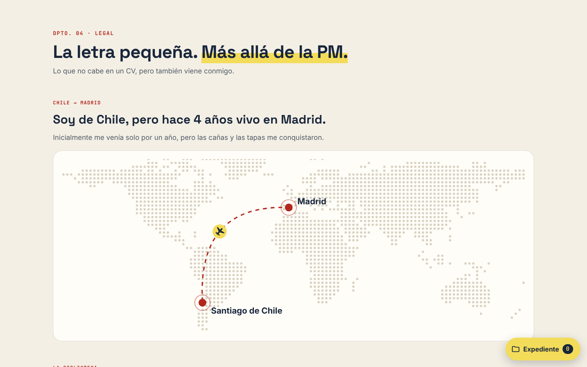

# El Despacho de Javiera

Portafolio interactivo para un puesto de **Senior Product Manager en la vertical de contabilidad** de una empresa de software de asesoría (contable, fiscal, laboral y legal).

🔗 **[Ver el sitio en vivo](https://jcerpamonrroy.github.io/despacho-de-javiera/)**

En vez de un CV más, el visitante entra a una asesoría. Su requerimiento se genera a partir de la oferta publicada, cada necesidad la atiende un departamento y, por el camino, va añadiendo «partidas» a su expediente. Al final se lleva la factura, sin coste.

| Dpto. Fiscal: marco de métricas de un agente de IA | Dpto. Legal: Chile → Madrid |
|---|---|
|  |  |

## Por qué existe

| | |
|---|---|
| **Problema** | Quien revisa candidaturas lee muchos CV que dicen «producto con IA», pero un CV afirma y no demuestra. |
| **Outcome** | Que el equipo de producto gane confianza en mi forma de pensar y construir, y que avancemos a una conversación. |
| **Hipótesis** | Un prototipo interactivo, pensado para su vertical, demuestra mejor cómo trabajo que un PDF, porque se experimenta en vez de solo leerse. Sabremos que es cierto si me invitan a conversar. |

## Cómo está organizado

| Sección | Metáfora | Qué cuenta |
|---|---|---|
| Recepción | Abrir un caso | De qué va el sitio |
| Requerimiento | El requerimiento del cliente | Los requisitos de la oferta, cada uno asignado a un departamento |
| Dpto. Contable | Cierre del ejercicio | Mi proceso de producto en Alegra Bot, en cinco asientos (Debe / Haber) |
| Dpto. Fiscal | Modelo tributario + inspección | Marco de métricas de un agente de IA y QA multiagente diario |
| Dpto. Laboral | Informe de vida laboral | Experiencia y lo que me llevo de cada etapa a producto |
| Ventanilla IA | Cómo se construyó | Problema → Outcome → Hipótesis → Prompt → Prototipo → Iteración |
| Dpto. Legal | La letra pequeña | Lo que no cabe en un CV: Chile → Madrid, libros, música y F1 |
| Facturación | La factura | Resumen del expediente y contacto |

## Cómo lo construí

Con **Claude** y **Claude Design**, en varias rondas:

1. **Concepto:** una asesoría con cuatro departamentos que calzan con mi CV.
2. **Ajuste a la oferta:** el requerimiento sale de la oferta publicada.
3. **Feedback de UX:** estructura, textos y tarjetas revisados sección por sección.
4. **Decidir qué quitar:** la primera versión tenía una «asesora virtual» por palabras clave. Respondía cosas que no correspondían, así que la quité: mejor no lanzar algo que no cumple el guardrail de calidad.

## Créditos

- Foto de Oasis: Raph_PH, [CC BY 4.0](https://creativecommons.org/licenses/by/4.0/).
- Foto de Abbey Road: _[completar autor y licencia]_.
